# Agents

An agent is an LLM that can **call Python functions** (tools) to get work done.

```
think (LLM) -> call tools -> send results back -> repeat
until the LLM answers without calling a tool, or max_steps is reached
```



## The math agent

```python
from rag_titan import get_settings
from rag_titan.agents import MathAgent
from rag_titan.factory import build_agent_llm

agent = MathAgent(build_agent_llm(get_settings()))
print(agent.run("What is (12 + 8) * 3?"))
```

The agent model must support tool calling, for example `qwen3:4b`:

```bash
ollama pull qwen3:4b
```

## Your own agent

A tool is a plain Python function. Its **docstring is sent to the LLM**, so
explain clearly what it does and what each argument means.

```python
from rag_titan.agents import BaseAgent


def word_count(text):
    """
    Count the words in a text.

    Args:
        text: the text to count
    """
    return len(str(text).split())


agent = BaseAgent(
    llm=llm,
    system_prompt="You count words. Always use the word_count tool.",
    tools=[word_count],
)
print(agent.run("How many words are in 'the quick brown fox'?"))
```

Call `agent.reset()` to start a new conversation.
