# Building blocks

Every RAG type is made of the same small parts. Each part has a **base class**
that says what methods it needs, and one or more ready-made classes.

```
Indexing:   Loader -> Chunker -> Embedder -> VectorStore
Answering:  Retriever -> Reranker -> Generator  (each uses the LLM / Embedder)
```




| Part      | Base class      | Ready-made classes                                | Folder                 |
|-----------|-----------------|---------------------------------------------------|------------------------|
| LLM       | `BaseLLM`       | `OllamaLLM`                                       | `llm/`                 |
| Loader    | `BaseLoader`    | `PdfLoader`, `DocxLoader`, `TextLoader`           | `loaders/`             |
| Chunker   | `BaseChunker`   | 8 chunkers, see [Chunking methods](chunking.md)   | `chunking/`            |
| Embedder  | `BaseEmbedder`  | `OllamaEmbedder`                                  | `embeddings/`          |
| Store     | `BaseStore`     | `MemoryStore`                                     | `vector_stores/`       |
| Retriever | –               | `Retriever`                                       | `retrieval/`           |
| Reranker  | `BaseReranker`  | `KeywordReranker`, `NoReranker`                   | `retrieval/rerankers/` |
| Generator | `BaseGenerator` | `GroundedGenerator`                               | `generation/`          |

## The data passed between parts

Everything is a plain Python `dict`, so it is easy to print and inspect.

**Document** (made by a loader)

```python
{"source": "handbook.pdf", "file_type": ".pdf", "text": "all the text..."}
```

**Chunk** (made by a chunker)

```python
{"id": "chunk_0", "source": "handbook.pdf", "text": "150 words..."}
```

**Match** (made by the retriever, then the reranker)

```python
{"id": "chunk_0", "source": "handbook.pdf", "text": "...",
 "score": 0.82, "rerank_score": 0.97}
```

## Chunkers

| Chunker            | Counts                 | Pick it with        | Good for                                |
|--------------------|------------------------|---------------------|-----------------------------------------|
| `WordChunker`      | words                  | `CHUNKER=word`      | the default, easy to reason about       |
| `CharacterChunker` | characters             | `CHUNKER=character` | any language, exact text kept           |
| `TokenChunker`     | tokens                 | `CHUNKER=token`     | staying under the embedding model limit |
| `RecursiveChunker` | characters (or tokens) | `CHUNKER=recursive` | keeping paragraphs and sentences whole  |
| `SentenceChunker`  | characters (or tokens) | `CHUNKER=sentence`  | exact sentences (FAQs, chat logs)       |
| `ParagraphChunker` | characters (or tokens) | `CHUNKER=paragraph` | reports and documentation               |
| `HeadingChunker`   | characters (or tokens) | `CHUNKER=heading`   | Markdown and Word files with headings   |
| `PageChunker`      | characters (or tokens) | `CHUNKER=page`      | PDFs where answers cite a page          |

```python
from rag_titan.chunking import RecursiveChunker

RecursiveChunker(chunk_size=1000, overlap=200).split_text(text)
```

How each one works, the sliding-window maths, overlap cost, tiktoken or your own
tokenizer, and how to choose: see **[Chunking methods](chunking.md)**.

## Building a RAG by hand

```python
from rag_titan import SimpleRAG
from rag_titan.chunking import WordChunker
from rag_titan.embeddings import OllamaEmbedder
from rag_titan.generation import GroundedGenerator
from rag_titan.llm import OllamaLLM
from rag_titan.pipelines import IndexingPipeline
from rag_titan.retrieval import Retriever
from rag_titan.retrieval.rerankers import KeywordReranker
from rag_titan.vector_stores import MemoryStore

llm = OllamaLLM("gemma3:4b")
embedder = OllamaEmbedder("nomic-embed-text")
store = MemoryStore()

IndexingPipeline(WordChunker(200, 40), embedder, store).run(["handbook.pdf"])

rag = SimpleRAG(Retriever(embedder, store), KeywordReranker(), GroundedGenerator(llm))
print(rag.answer("How many leave days do I get?"))
```

## Prompts

All RAG prompts live in `rag_titan/prompts.py` so they are easy to read and tune.
To use your own answer prompt:

```python
GroundedGenerator(llm, instructions="Answer in one short sentence. Cite chunk ids.")
```
