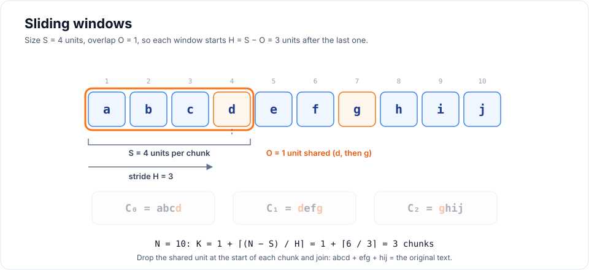

# Chunking methods

A RAG system never searches whole files. It searches **chunks**: small pieces of
text that are embedded and stored one by one. How you cut the text decides what
the retriever can find, so chunking is one of the settings that matters most.

- Chunks that are **too big** mix several topics. Their vectors get blurry and the
  LLM receives a lot of text it does not need.
- Chunks that are **too small** lose context. "It is 20 days" means nothing
  without the sentence before it.

rag-titan ships eight chunkers in two families from the chunking handbook:
**fixed-size** (section 2) cuts by counting units, and **structure-aware**
(section 3) keeps the document's own units whole. More families are on the
[roadmap](roadmap.md).

| Chunker            | Family          | Counts                 | Setting             | Keeps whole                                |
|--------------------|-----------------|------------------------|---------------------|--------------------------------------------|
| `WordChunker`      | fixed-size      | words                  | `CHUNKER=word`      | words                                      |
| `CharacterChunker` | fixed-size      | characters             | `CHUNKER=character` | nothing (exact text)                       |
| `TokenChunker`     | fixed-size      | model tokens           | `CHUNKER=token`     | tokens                                     |
| `RecursiveChunker` | fixed-size      | characters (or tokens) | `CHUNKER=recursive` | paragraphs, lines, sentences when they fit |
| `SentenceChunker`  | structure-aware | characters (or tokens) | `CHUNKER=sentence`  | sentences                                  |
| `ParagraphChunker` | structure-aware | characters (or tokens) | `CHUNKER=paragraph` | paragraphs                                 |
| `HeadingChunker`   | structure-aware | characters (or tokens) | `CHUNKER=heading`   | sections (never mixes two)                 |
| `PageChunker`      | structure-aware | characters (or tokens) | `CHUNKER=page`      | pages (never spans two)                    |

!!! tip "Try it: chunk playground"
    Paste your own text and watch every chunker on this page cut it, live in
    your browser: **[open the chunk playground](playground.md)**.

## What every chunker returns

Every chunker inherits from `BaseChunker`, so they all work the same way:
`split_text(text)` returns a list of strings, and `chunk(documents)` turns
document dicts into chunk dicts with an id and the source file.

```python
from rag_titan.chunking import WordChunker

WordChunker(chunk_size=4, overlap=0).chunk(
    [{"source": "policy.pdf", "text": "Staff get twenty days of paid leave."}]
)
# [{'id': 'chunk_0', 'source': 'policy.pdf', 'text': 'Staff get twenty days'},
#  {'id': 'chunk_1', 'source': 'policy.pdf', 'text': 'of paid leave.'}]
```

## Sliding windows: the maths behind fixed-size chunking

`WordChunker`, `CharacterChunker` and `TokenChunker` all do the same thing on a
different kind of *unit* (a word, a character or a token). They share one helper,
`fixed_windows()`, and one set of formulas.

### The window

Write the text as a list of $N$ units $D = (u_1, u_2, \dots, u_N)$ and pick:

- the **size** $S$: units per chunk (`chunk_size`)
- the **overlap** $O$: units shared by two neighbouring chunks, with $0 \le O < S$

Each new window starts $H$ units after the previous one. $H$ is the **stride**:

$$
H = S - O
$$

Window number $i$ (counting from 0) holds the units from position $iH$ up to,
but not including, $iH + S$:

$$
C_i = \big(u_{iH+1},\ \dots,\ u_{\min(iH+S,\ N)}\big)
$$

The last window may be shorter than $S$. All the others have exactly $S$ units.

```python
from rag_titan.chunking import fixed_windows

fixed_windows([1, 2, 3, 4, 5, 6, 7], size=3, overlap=1)
# [[1, 2, 3], [3, 4, 5], [5, 6, 7]]     S = 3, O = 1, H = 2

fixed_windows("abcdefghij", size=4, overlap=1)
# ['abcd', 'defg', 'ghij']              S = 4, O = 1, H = 3
```



!!! warning "Why overlap must be smaller than size"
    With $O \ge S$ the stride $H$ is zero or negative, so the window would never
    move forward. Every chunker raises `ValueError` for that, and for $S \le 0$
    or $O < 0$.

### How many chunks?

The number of windows $K$ for a text of $N$ units is:

$$
K =
\begin{cases}
0 & \text{if } N = 0 \\
1 & \text{if } 0 < N \le S \\
1 + \left\lceil \dfrac{N - S}{H} \right\rceil & \text{if } N > S
\end{cases}
$$

`count_windows(n, size, overlap)` computes $K$ without making the chunks, and
the tests check it against `len(fixed_windows(...))` for every length up to 40.

### What overlap costs

Overlap stores some text twice. Compared with no overlap, the index grows by
about the **amplification factor**:

$$
A \approx \frac{S}{H} = \frac{S}{S - O} = \frac{1}{1 - o}
\qquad \text{where } o = \frac{O}{S}
$$

So 10% overlap costs about 11% more vectors, 20% costs 25% and 40% costs 67%.
Check it for your own data before indexing:

```python
from rag_titan.chunking import count_windows

# a 10,000-word handbook in 500-word chunks
count_windows(10_000, 500, 0)     # 20 chunks
count_windows(10_000, 500, 50)    # 23 chunks  (10% overlap)
count_windows(10_000, 500, 100)   # 25 chunks  (20% overlap, A = 1.25)
count_windows(10_000, 500, 200)   # 33 chunks  (40% overlap)
```

Overlap helps when an answer sits on a boundary between two chunks. It also
means neighbouring chunks are similar, so the retriever may return two chunks
with mostly the same text. More overlap is not automatically better.

### Guarantees

Every fixed-size chunker is tested for these rules (from the handbook's
acceptance tests):

- **Nothing is lost.** Dropping the first $O$ units of every chunk except the
  first and joining the rest gives back the original units:
  $D = C_0 \,\Vert\, C_1[O{:}] \,\Vert\, C_2[O{:}] \,\Vert\, \cdots$
- **No empty chunks.** Empty or blank text gives `[]`.
- **Exact sizes.** Every chunk has $S$ units except the last one.
- **Fast.** One pass over the text: time grows linearly with the text,
  $\mathcal{O}(N)$, plus $\mathcal{O}(K \cdot S)$ to copy the chunks out.

### One sentence, three units

The only difference between the three fixed-size chunkers is what they count.
Here is the same sentence cut by each one (real output):



## WordChunker

Splits on whitespace and counts words. It is the default because word counts are
easy to reason about: "150 words" is roughly one paragraph.



*Watch each window of 6 words light up; the 2 shared words are filled orange.*

```python
from rag_titan.chunking import WordChunker

WordChunker(chunk_size=5, overlap=2).split_text(
    "Staff get twenty days of paid leave every year."
)
# ['Staff get twenty days of', 'days of paid leave every', 'leave every year.']
```

| | |
|---|---|
| **Unit** | a word (`text.split()`) |
| **Settings** | `CHUNKER=word`, `CHUNK_SIZE=150`, `CHUNK_OVERLAP=30` (the defaults) |
| **Good for** | a simple, predictable start on prose |
| **Watch out** | line breaks and double spaces become single spaces; word count is only roughly model tokens (about 1.3 tokens per English word) |

## CharacterChunker

Cuts the raw string every $S$ characters (handbook 2.1). The text is kept exactly
as it is, spaces and newlines included, so it works for any language, even ones
without spaces between words.



*Each box is one character. Note the cuts in the middle of words: `the fo` | `rm`.*

```python
from rag_titan.chunking import CharacterChunker

CharacterChunker(chunk_size=12, overlap=4).split_text("Leave policy: twenty days.")
# ['Leave policy', 'licy: twenty', 'enty days.']
```

| | |
|---|---|
| **Unit** | a character |
| **Settings** | `CHUNKER=character`, for example `CHUNK_SIZE=1000`, `CHUNK_OVERLAP=150` |
| **Good for** | exact, lossless chunks; languages without spaces; code or logs |
| **Watch out** | chunks start and end in the middle of words (`'licy: twenty'`) |

## TokenChunker

Counts **model tokens**, the units an embedding model reads (handbook 2.3). Every
embedding model has a maximum input length in tokens. Counting with the same
tokenizer is the only way to be sure no chunk is cut off by the model.



*Real tiktoken tokens: the blank line is one token, and each full stop is its own.*

The text is encoded to token ids, the ids are cut with `fixed_windows`, and each
window is decoded back to text:

```python
from rag_titan.chunking import TokenChunker

chunker = TokenChunker(chunk_size=6, overlap=2)     # tiktoken, "cl100k_base"
text = "Tokenizers split unbelievably long words into pieces."

[chunker.tokenizer.decode([i]) for i in chunker.tokenizer.encode(text)]
# ['Token', 'izers', ' split', ' unbelie', 'vably', ' long',
#  ' words', ' into', ' pieces', '.']                   10 tokens

chunker.split_text(text)
# ['Tokenizers split unbelievably long', 'vably long words into pieces.']
```

Notice that one word can be several tokens, and a chunk can start inside a word
(`'vably'`).

### tiktoken (default)

tiktoken is an optional extra, so install it first:

```bash
pip install "rag-titan[tokens]"
```

Pick the encoding with `encoding=` or `CHUNK_ENCODING` (default `cl100k_base`).
tiktoken downloads the encoding file the first time it is used, so the first run
needs internet.

### Your own tokenizer

Pass any object with `encode(text)` returning a list of ids and `decode(ids)`
returning text. Use this to count exactly like your embedding model, for example
a Hugging Face model:

```python
from transformers import AutoTokenizer

from rag_titan.chunking import TokenChunker


class HFTokenizer:
    def __init__(self, name):
        self.tokenizer = AutoTokenizer.from_pretrained(name)

    def encode(self, text):
        # no [CLS]/[SEP]: we only want to count the text itself
        return self.tokenizer.encode(text, add_special_tokens=False)

    def decode(self, ids):
        return self.tokenizer.decode(ids)


chunker = TokenChunker(chunk_size=256, overlap=32, tokenizer=HFTokenizer("BAAI/bge-small-en-v1.5"))
```

| | |
|---|---|
| **Unit** | a model token |
| **Settings** | `CHUNKER=token`, `CHUNK_ENCODING=cl100k_base`, for example `CHUNK_SIZE=256`, `CHUNK_OVERLAP=32` |
| **Good for** | staying under the embedding model's limit; comparable chunk sizes across languages |
| **Watch out** | needs tiktoken or your own tokenizer; decoding and encoding again can shift a count by a token at the edges with some tokenizers |

## RecursiveChunker

Fixed windows ignore the meaning of the text. `RecursiveChunker` (handbook 2.5)
keeps the same size limit but prefers to cut where the text already has a break.



*The extra sentence "Dr. Lee signs it within 3.5 days." shows the weak spot: recursive splits on any `". "`, so `Dr.` ends up at the end of the previous chunk. Compare with `SentenceChunker` below.*

### How it works

It has a list of separators, biggest first:

| Order | Separator | Breaks at  |
|-------|-----------|------------|
| 1     | `"\n\n"`  | paragraphs |
| 2     | `"\n"`    | lines      |
| 3     | `". "`    | sentences  |
| 4     | `" "`     | words      |
| 5     | `""`      | anywhere (hard cut, last resort) |

1. **Split.** If the text fits in $S$, keep it. Otherwise split on the first
   separator that appears in it, keeping the separator at the end of each piece
   so no text is lost. Any piece that is still too big is split again with the
   *next* separator.
2. **Merge.** Walk through the pieces and pack them into a chunk until the next
   piece would make it bigger than $S$.
3. **Overlap.** Start the next chunk with the last *whole* pieces of the previous
   one, as long as they add up to at most $O$.

```text
split(text, separators):
    if size(text) <= S:            return [text]
    sep = first separator found in text
    if sep == "":                  return hard_cut(text)          # fixed_windows
    pieces = []
    for part in text split on sep (sep kept):
        pieces += split(part, separators after sep)
    return pieces

merge(pieces):
    chunk = []
    for piece in pieces:
        if size(chunk + piece) > S:
            emit chunk
            chunk = last whole pieces of chunk with total size <= O
        chunk += piece
    emit chunk
```

In symbols: with piece sizes $\ell(p_j)$, each chunk is the longest run of
pieces $p_a, \dots, p_b$ with

$$
\sum_{j=a}^{b} \ell(p_j) \le S
$$

and the overlap is the longest run of whole pieces at its end with
$\sum \ell(p_j) \le O$.

### Example

```python
from rag_titan.chunking import RecursiveChunker

doc = (
    "Leave policy\n\n"
    "Staff get twenty days. Unused days carry over. "
    "Ask HR for the form. Sick leave is separate."
)

RecursiveChunker(chunk_size=50, overlap=0).split_text(doc)
# ['Leave policy\n\nStaff get twenty days.',
#  'Unused days carry over. Ask HR for the form.',
#  'Sick leave is separate.']

RecursiveChunker(chunk_size=50, overlap=25).split_text(doc)
# ['Leave policy\n\nStaff get twenty days.',
#  'Staff get twenty days. Unused days carry over.',
#  'Unused days carry over. Ask HR for the form.',
#  'Ask HR for the form. Sick leave is separate.']
```

The second paragraph is longer than 50 characters, so it falls back to
sentences. No sentence is ever cut, and with overlap each chunk repeats the
previous sentence.

!!! note "Overlap is *up to* `overlap`"
    Only whole pieces are repeated. A piece longer than $O$ is never repeated,
    so with long sentences and a small overlap you may see no overlap at all.
    That is on purpose: cutting a sentence in half to fill the overlap would
    defeat the point of this chunker.

### Options

```python
RecursiveChunker(
    chunk_size=1000,
    overlap=200,
    separators=("\n\n", "\n", ". ", " ", ""),   # biggest first; "" = hard cut
    tokenizer=None,                             # pass one to count tokens
)
```

For Markdown you could try `separators=("\n## ", "\n### ", "\n\n", "\n", ". ", " ", "")`
so headings start new chunks.

| | |
|---|---|
| **Unit** | characters, or tokens with `tokenizer=` |
| **Settings** | `CHUNKER=recursive`, for example `CHUNK_SIZE=1000`, `CHUNK_OVERLAP=200` |
| **Good for** | a strong general default for reports, docs and policies |
| **Watch out** | spaces at the edges of chunks are trimmed; with a tokenizer, piece token counts are added up, which can differ from encoding the whole chunk by about a token |

## Structure-aware chunkers

Fixed-size chunkers count units. Structure-aware chunkers (handbook section 3)
first cut the text into the units the author wrote: sentences, paragraphs,
sections or pages. Then they pack whole units into chunks of at most
`chunk_size`, with the same packing step as `RecursiveChunker`:

$$
C_j = (u_a, \dots, u_b) \qquad \text{with} \qquad \sum_{i=a}^{b} \ell(u_i) \le S
$$

A unit is only cut when it is bigger than $S$ on its own: a paragraph falls
back to sentences, and a sentence falls back to words. Overlap repeats whole
units, up to $O$. Sizes count characters, or tokens with `tokenizer=`.

### What the loaders keep

These chunkers need the document's structure, so the loaders keep it:

| File          | Paragraphs                | Headings                                  | Pages                          |
|---------------|---------------------------|-------------------------------------------|--------------------------------|
| `.docx`       | separated by a blank line | Word "Heading 1-6" become `#` to `######` | no pages in Word files         |
| `.pdf`        | lines as pypdf reads them | none                                      | separated by `\f` (page break) |
| `.md`, `.txt` | as written                | Markdown `#` headings                     | none                           |

### SentenceChunker

Packs whole sentences (handbook 3.1). The sentence splitter needs no library
and knows the common traps: abbreviations (`Dr.`, `Mr.`, `etc.`, `Fig.`),
dotted forms (`e.g.`, `U.S.`), initials (`J. K.`), list numbers (`1.`),
decimals (`3.5`), quotes, `...`, and the end marks `。！？।` used in Japanese,
Chinese and Hindi.



*Same text as the recursive diagram: here `Dr. Lee signs it within 3.5 days.` stays whole.*

```python
from rag_titan.chunking import SentenceChunker
from rag_titan.chunking.structure_aware import split_sentences

split_sentences("Dr. Smith said it takes 3.5 days. Ask HR, e.g. Ann. Done!")
# ['Dr. Smith said it takes 3.5 days. ', 'Ask HR, e.g. Ann. ', 'Done!']

doc = (
    "# Leave policy\n\n"
    "Staff get twenty days. Unused days carry over. Ask HR for the form.\n\n"
    "Sick leave is separate. Tell your manager before nine."
)
SentenceChunker(chunk_size=50, overlap=25).split_text(doc)
# ['# Leave policy\n\nStaff get twenty days.',
#  'Staff get twenty days. Unused days carry over.',
#  'Unused days carry over. Ask HR for the form.',
#  'Ask HR for the form.\n\nSick leave is separate.',
#  'Tell your manager before nine.']
```

!!! note "One trade-off"
    A single letter before a full stop is read as an initial, like `J. K.`
    So `"Plan B. Then we go."` stays one sentence. That is the safer mistake:
    gluing two sentences together loses nothing, while cutting a name in two
    would.

| | |
|---|---|
| **Settings** | `CHUNKER=sentence`, for example `CHUNK_SIZE=500`, `CHUNK_OVERLAP=100` (defaults) |
| **Good for** | FAQs, chat logs, short answers: retrieving the exact sentences |
| **Watch out** | a chunk can join the end of one paragraph with the start of the next |

### ParagraphChunker

Packs whole paragraphs, separated by a blank line (handbook 3.2). The handbook
calls paragraph grouping "frequently a strong general baseline for reports and
documentation".



*The same sentences written as paragraphs: the heading packs with the first paragraph.*

```python
from rag_titan.chunking import ParagraphChunker

ParagraphChunker(chunk_size=60, overlap=0).split_text(doc)
# ['# Leave policy\n\nStaff get twenty days.',
#  'Unused days carry over. Ask HR for the form.',
#  'Sick leave is separate. Tell your manager before nine.']
```

The middle paragraph has 69 characters, more than 60, so it falls back to
sentences. The last paragraph fits, so it stays whole.

| | |
|---|---|
| **Settings** | `CHUNKER=paragraph`, for example `CHUNK_SIZE=1000`, `CHUNK_OVERLAP=0` (defaults) |
| **Good for** | reports, policies, documentation, Word files |
| **Watch out** | PDFs give lines, not paragraphs, so on PDFs it packs lines |

### HeadingChunker

Splits at headings, so **a chunk never mixes two sections**, and starts each
chunk with its **heading path** (handbook 3.3). A heading closes every open
heading at its level or deeper, which builds the path:



*Each chunk stays inside its section and starts with its heading path.*

$$
C_i = (h_1, \dots, h_d,\ \text{body}_i)
$$

```python
from rag_titan.chunking import HeadingChunker

md = (
    "# Leave policy\n\n## Annual leave\n\nStaff get twenty days.\n\n"
    "## Sick leave\n\nTell your manager.\n\n# Travel\n\nBook trips early."
)
HeadingChunker(chunk_size=200).split_text(md)
# ['Leave policy > Annual leave\n\nStaff get twenty days.',
#  'Leave policy > Sick leave\n\nTell your manager.',
#  'Travel\n\nBook trips early.']

HeadingChunker(chunk_size=200, include_path=False).split_text(md)
# ['# Leave policy\n\n## Annual leave\n\nStaff get twenty days.',
#  '## Sick leave\n\nTell your manager.',
#  '# Travel\n\nBook trips early.']
```

- The path tells the retriever and the LLM *where* a chunk comes from: "20
  days" means little until you know it is under *Annual leave*.
- The path counts toward `chunk_size`. If it would take more than half of
  a chunk, it is left out.
- `#` lines inside code blocks (```` ``` ````) are code, not headings.
- Inside a section, paragraphs are packed like `ParagraphChunker`.

| | |
|---|---|
| **Settings** | `CHUNKER=heading`, for example `CHUNK_SIZE=1000`, `CHUNK_OVERLAP=0` (defaults) |
| **Good for** | Markdown docs, Word files with headings, handbooks, wikis |
| **Watch out** | text with no headings becomes one section; very short sections make very short chunks |

### PageChunker

Chunks each page on its own, so **a chunk never spans two pages**
(handbook 3.4). A page that fits is one chunk; a bigger page is cut into
paragraphs, then sentences. Empty pages are skipped.



*Pages 1 and 2 would fit in one 70-character chunk, but they stay separate.*

```python
from rag_titan.chunking import PageChunker

PageChunker(chunk_size=30).split_text(
    "Page one text.\fPage two is longer and has more words in it.\f\fLast page."
)
# ['Page one text.', 'Page two is longer and has', 'more words in it.', 'Last page.']
```

| | |
|---|---|
| **Settings** | `CHUNKER=page`, for example `CHUNK_SIZE=2000`, `CHUNK_OVERLAP=0` (defaults) |
| **Good for** | PDFs where answers should cite a page, such as contracts or manuals |
| **Watch out** | a table or sentence that runs across a page break is cut there; files without pages are one page |

## Choosing a chunker

| If you need...                                  | Use                |
|-------------------------------------------------|--------------------|
| a quick start that is easy to explain           | `WordChunker`      |
| exact text, any language, code or logs          | `CharacterChunker` |
| to stay under the embedding model's token limit | `TokenChunker`     |
| readable chunks that keep sentences together    | `RecursiveChunker` |
| retrieving exact sentences (FAQs, chat logs)    | `SentenceChunker`  |
| a strong baseline for reports and documents     | `ParagraphChunker` |
| chunks that know their section (docs, wikis)    | `HeadingChunker`   |
| answers that cite a page (PDF contracts)        | `PageChunker`      |

There is no size that is best for every dataset. The handbook suggests treating
these as experiments, not answers:

- try **256, 512 and 768 tokens** per chunk
- try **overlap 0 and 10-15%** of the chunk size
- keep the retriever and the LLM the same, ask the same set of real questions,
  and keep the setting that finds the right chunk most often

Rough conversions for English: 150 words $\approx$ 200 tokens $\approx$ 900
characters. When you switch `CHUNKER`, change `CHUNK_SIZE` and `CHUNK_OVERLAP`
with it, because they count different units:

```bash
# .env
CHUNKER=recursive
CHUNK_SIZE=1000      # characters
CHUNK_OVERLAP=150
```

## Writing your own chunker

Inherit `BaseChunker` and write `split_text()`. `fixed_windows()` works on any
list, so you can make sliding windows of *anything*, here sentences:

```python
from rag_titan.chunking import BaseChunker, fixed_windows


class SentenceWindowChunker(BaseChunker):
    """Windows of whole sentences that overlap."""

    def __init__(self, sentences=3, overlap=1):
        self.sentences = sentences
        self.overlap = overlap

    def split_text(self, text):
        parts = [part.strip() + "." for part in text.split(".") if part.strip()]
        windows = fixed_windows(parts, self.sentences, self.overlap)
        return [" ".join(window) for window in windows]


SentenceWindowChunker(sentences=2, overlap=1).split_text("One. Two. Three. Four.")
# ['One. Two.', 'Two. Three.', 'Three. Four.']
```

See [Extending rag-titan](extending.md#where-chunkers-live) for where to put it
and how to make it selectable with `CHUNKER=...`.

## What's next

The handbook groups chunking methods into families. rag-titan adds them one
family at a time, each in its own folder under `rag_titan/chunking/`:

- [x] **Fixed-size** (`fixed_size/`): word, character, token, recursive
- [x] **Structure-aware** (`structure_aware/`): sentence, paragraph, heading, page
- [ ] **Element-aware**: keep lists, tables and code blocks whole (handbook 3.5-3.7)
- [ ] **Semantic**: split where the meaning changes, using embeddings
- [ ] **Hierarchical**: small chunks for search, big chunks for answers
