# Command line

Installing the package adds a `rag-titan` command.



## Ask one question

```bash
rag-titan ask --files handbook.pdf --question "How many leave days do I get?"
```

## Chat in a loop

```bash
rag-titan chat --files handbook.pdf policy.docx --rag-type adaptive
```

Type `exit` to quit.

## Options

| Option        | Used by     | Meaning                                   |
|---------------|-------------|-------------------------------------------|
| `--files`     | ask, chat   | PDF, DOCX, MD or TXT files (required)     |
| `--rag-type`  | ask, chat   | `simple` (default) or `adaptive`          |
| `--log-level` | ask, chat   | `DEBUG`, `INFO` or `WARNING` (default)    |
| `--question`  | ask         | the question to answer (required)         |
| `--version`   | –           | print the version                         |

The CLI also reads your `.env` file, see [Configuration](configuration.md).
