# Extending rag-titan

Every part works the same way:

1. create a class that inherits from the part's **base class**
2. write the methods the base class asks for
3. (optional) add one `if name == ...` line in `factory.py` so it can be chosen from settings

## Example: a new chunker

```python
from rag_titan.chunking import BaseChunker


class LineChunker(BaseChunker):
    """Splits text into groups of lines (for logs, CSV-like text, poems)."""

    def __init__(self, lines_per_chunk=20):
        self.lines_per_chunk = lines_per_chunk

    def split_text(self, text):
        """Return pieces of `lines_per_chunk` non-empty lines each."""
        lines = [line for line in text.splitlines() if line.strip()]
        pieces = []

        for start in range(0, len(lines), self.lines_per_chunk):
            group = lines[start:start + self.lines_per_chunk]
            pieces.append("\n".join(group))

        return pieces
```

Then register it in `factory.py`:

```python
def build_chunker(settings):
    name = settings["chunker"]

    if name == "word":
        return WordChunker(settings["chunk_size"], settings["chunk_overlap"])
    if name == "line":
        return LineChunker()
    ...
```

and set `CHUNKER=line` in `.env`.

### Where chunkers live

Chunkers are grouped by family, one sub-folder each, following the chunking
handbook. A new family gets its folder when its first chunker is added.

```text
chunking/
├── base_chunker.py          # BaseChunker, shared by every family
├── packing.py               # pack(): whole pieces up to a size, whole-piece overlap
├── fixed_size/              # characters, words, tokens, recursive separators
│   ├── fixed_windows.py     # fixed_windows(), count_windows()
│   ├── word_chunker.py
│   ├── character_chunker.py
│   ├── token_chunker.py
│   └── recursive_chunker.py
└── structure_aware/         # sentences, paragraphs, heading sections, pages
    ├── base.py              # PieceChunker: cut into pieces, then pack()
    ├── sentences.py         # split_sentences(), split_paragraphs()
    ├── sentence_chunker.py
    ├── paragraph_chunker.py
    ├── heading_chunker.py
    └── page_chunker.py
```

A chunker that keeps whole units can inherit `PieceChunker` and only write
`pieces(text)`; size checks, packing and overlap come for free. The line chunker
above is a structure-aware idea, so it would go in `chunking/structure_aware/`.
Export it from that folder's `__init__.py` and from `chunking/__init__.py`, so
users can write `from rag_titan.chunking import LineChunker`.



## What each base class needs

| Base class      | Methods to write                                  |
|-----------------|---------------------------------------------------|
| `BaseLLM`       | `chat(messages, tools)`, `tool_result_message()`  |
| `BaseLoader`    | `extensions` list and `extract_text(path)`        |
| `BaseChunker`   | `split_text(text)`                                |
| `BaseEmbedder`  | `embed_many(texts)`                               |
| `BaseStore`     | `add()`, `search()`, `clear()`, `count()`         |
| `BaseReranker`  | `score(query, match)`                             |
| `BaseGenerator` | `generate(query, chunks)`                         |

## Adding a new RAG type

1. create `src/rag_titan/rag_types/my_rag.py` with a class that has an
   `answer(query)` method
2. add it to `RAG_TYPES` and `build_rag()` in `factory.py`
3. export it in `rag_types/__init__.py`
4. add tests in `tests/` (use `FakeLLM` and `FakeEmbedder` from `conftest.py`)
5. document it in `docs/rag-types.md`

## Code style

- keep functions short (under about 50 lines) and files under about 200 lines
- no type hints, plain dicts and lists
- a docstring for every class and public method
- comments explain **why**, not what
