# Getting started

## 1. Install the package

```bash
pip install rag-titan
```

Python 3.10 or newer is required.

## 2. Install Ollama and pull the models

`rag-titan` uses [Ollama](https://ollama.com) to run models on your own computer.

```bash
ollama pull gemma3:4b          # chat model, writes the answers
ollama pull nomic-embed-text   # embedding model, turns text into vectors
```

Make sure Ollama is running (`ollama serve`, or open the Ollama app).

## 3. Ask your first question

```python
from rag_titan import RAGTitan, setup_logging

setup_logging("INFO")              # optional: show what is happening

rag = RAGTitan(rag_type="simple")
chunk_count = rag.index(["handbook.pdf", "policy.docx"])
print(f"Indexed {chunk_count} chunks")

print(rag.ask("How many leave days do I get?"))
```

What happens:

1. `index()` reads each file, splits it into chunks, turns every chunk into a
   vector and saves it in memory.
2. `ask()` turns the question into a vector, finds the most similar chunks,
   reranks them and asks the LLM to answer using only those chunks.

The answer cites the chunks it used, for example `[chunk_0]`.



## 4. Try another RAG type

```python
rag = RAGTitan(rag_type="adaptive")
```

See [RAG types](rag-types.md) for the differences.

!!! note "Data lives in memory"
    The default vector store keeps everything in memory, so you must call
    `index()` again each time your program starts.
