RAG lets a language model answer questions about *your* documents. It first
**finds** the most relevant pieces of text, then asks the model to **answer
using only those pieces**.

`rag-titan` gives you many types of RAG in one small package. The code is
written so a beginner can read every file:

- small classes, short functions, plain Python, no type hints
- every class and function has a docstring
- every part can be replaced by inheriting from one base class

```python
from rag_titan import RAGTitan

rag = RAGTitan(rag_type="simple")
rag.index(["handbook.pdf"])
print(rag.ask("How many leave days do I get?"))
```



## Where to go next

| I want to...                         | Read                                   |
|--------------------------------------|----------------------------------------|
| install it and ask my first question | [Getting started](getting-started.md)  |
| choose a RAG type                    | [RAG types](rag-types.md)              |
| understand each part                 | [Building blocks](building-blocks.md)  |
| change models or chunk sizes         | [Configuration](configuration.md)      |
| add my own vector store or LLM       | [Extending rag-titan](extending.md)    |
